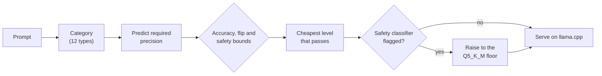
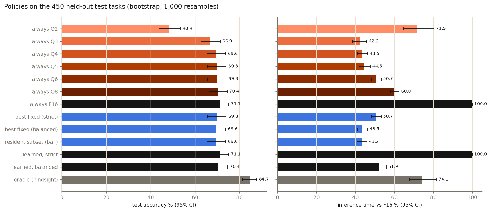

# QuantRoute

**Serve each LLM prompt at the cheapest quantization level that stays accurate and safe.**

QuantRoute runs one model, Qwen2.5-3B-Instruct, at seven GGUF quantization levels (Q2_K, Q3_K_M, Q4_K_M, Q5_K_M, Q6_K, Q8_0 and the F16 reference) on a single 8 GB RTX 4060. It measures every level on 1,467 graded tasks and 600 safety prompts, learns which level each kind of prompt needs, and serves each request at the cheapest level whose accuracy, answer stability and safety stay within set bounds of F16. The policy runs as a local HTTP service with a page that shows every routing decision.

It is also a measurement study, and the main finding is a negative one. On this model, per-prompt routing does not beat simply serving the best single safe level (Q5_K_M). Below 4 bits accuracy collapses, and the prompt text says little about which level a question needs. The full write-up is in [`results/REPORT.md`](results/REPORT.md).

| | |
|---|---|
| Results dashboard | https://quant-precision-router.vercel.app |
| Replay demo (450 held-out questions, no install) | https://quant-precision-router.vercel.app/demo |


## How it works



- **Offline:** every task is run at every level and graded (14,469 runs). Each task is labelled with the cheapest level that solves it confidently, a predictor learns that label from the prompt, and pooled statistical models give accuracy and flip bounds for each of 84 (category × predicted class) cells.
- **Online:** routing is a table lookup plus a safety check, about 10 ms on the CPU. Two operating points are offered. **Strict** (the fitted bounds) serves F16 everywhere, because no cheaper level passes them. **Balanced** loosens the bounds and uses Q3_K_M to F16.

## Results

All numbers are on the 450 held-out test tasks unless noted. Details and confidence intervals are in [`results/REPORT.md`](results/REPORT.md).

| | |
|---|---|
| 4-bit is nearly free | Q4_K_M scores 72.0% against F16's 73.4% (all tasks), in 35% of the GPU memory |
| 2-bit collapses | Q2_K drops to 51.2% |
| Prompts barely predict required precision | 45.8% exact, against 45.5% for always guessing the most common level |
| Routing vs one fixed level | Balanced routing scores 70.4% at 52% of F16's GPU time. Always-Q5_K_M scores 69.8% at 45%, and always-F16 scores 71.1%. The accuracy differences are within the noise |
| Switching costs | Spreading prompts over six levels on one GPU means about 780 model loads per 1,000 random-order requests, which costs more than always running F16 |
| Safety floor | Q2_K–Q4_K_M exceed a 5% safety-flip bound, so flagged prompts never go below Q5_K_M. The classifier catches 96% of harmful test prompts |
| Refusal grading | An LLM-judged audit found the string matcher misses most of Qwen's refusals. A stricter matcher leaves the floor unchanged |
| Attacks on the router | A four-word suffix sends 98% of cheap prompts to F16, and neither defence stops it; per-key rate limits cap the cost. Another suffix gets 59% of harmful prompts below the safety floor by slipping past the safety classifier; with it, the model refused 4–9% of them, against 45% unattacked at F16 |
| Service | The live API matched the router's decision on 12 of 12 requests and reproduced the benchmark's answers exactly (5 of 5) |



## Getting started

Requirements: an NVIDIA GPU with CUDA 12 (8 GB used here), Windows 11, Python 3.13, and Docker Desktop (needed only for grading code tasks). A Fireworks API key is needed only to regenerate tasks or rerun the refusal audit.

```powershell
python -m venv .venv
.venv\Scripts\pip install -r requirements.lock.txt
.venv\Scripts\pip install -e .
.venv\Scripts\python -m pytest -q          # unit tests; -m docker and -m gpu run the rest
```

The full pipeline, in order (`python -m quantlab <command>`):

```text
setup-llama        pinned llama.cpp CUDA build (b11451)
download-models    the seven levels at a pinned commit, hash-checked
build-safety       XSTest plus prompt-injection variants (downloaded, not redistributed)
profile-quants     VRAM, residency and load time per level
bench --slice all  the measurement grid, about 3 hours, resumable
kl                 KL divergence against F16 on WikiText-2
analyze            labels, predictor, pooled models, safety, policy, baselines, sweep, bootstrap, figures
audit-refusals     LLM-judged check of the refusal matcher
service-check      live API check on the GPU
adversarial        cost-inflation and downgrade attacks, with and without defences
report             results/REPORT.md
```

The generated tasks are committed, so `build-seeds` and `generate-tasks` can be skipped.

**Run the service:**

```powershell
$env:QUANTLAB_API_KEY = .venv\Scripts\python -c "import secrets;print(secrets.token_urlsafe(32))"
.venv\Scripts\python -m quantlab serve       # http://localhost:8000, enter the key on the page
```

The service checks the API key in constant time, rejects prompts over 8,000 characters, rate-limits each key (30 requests per minute, 5 at F16), never serves a flagged prompt below the floor, and logs only a hash of each prompt. To use it from another computer, run `cloudflared tunnel --url http://127.0.0.1:8000` and open the printed address.

**Browse the results locally:**

```powershell
.venv\Scripts\python -m streamlit run dashboard/app.py --server.address 127.0.0.1 --server.port 8501
```

## Repository layout

```text
config.yaml          all settings: ladder, llama.cpp build, decoding, policy bounds, API limits
src/quantlab/        the pipeline, router, API and evaluation (one module per stage)
tests/               unit tests (Docker and GPU tests are marked)
data/                benchmark tasks and generation logs (XSTest is not committed)
models/models.lock.json   pinned model revision and per-file SHA-256
results/             measured and fitted results, figures and REPORT.md (the raw grid is not committed)
dashboard/app.py     local Streamlit dashboard
dashboard-site/      the static results site and replay demo
```

## Data and licences

- Benchmark tasks: 135 hand-written seeds plus 1,332 tasks generated and verified by gpt-oss-120b.
- XSTest (Röttger et al., 2024) is downloaded at build time and not redistributed, because its repository declares no licence.
- WikiText-2 is downloaded for the KL measurement. Model files come from the official Qwen GGUF repository and are not committed.

## Limitations

One model on one GPU. The safety floor is only as strong as the safety classifier, which a short appended suffix can evade. Refusals are graded by string matching, which undercounts them. Swap costs assume a random request order, close to a worst case. Difficulty tiers are heuristic. The differential backdoor test was never checked against a planted backdoor. See the report for the full list.

## Credits

The graders, task-type classifier and seed tasks are adapted from the author's earlier CheapRoute project. Qwen2.5-3B-Instruct is by the Qwen Team and is served with llama.cpp. Safety prompts come from XSTest, and embeddings from all-MiniLM-L6-v2.
